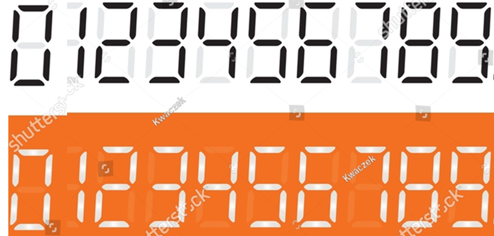
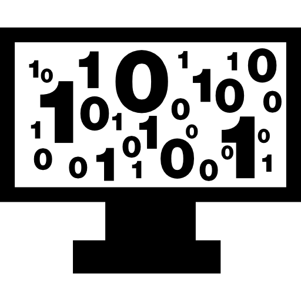
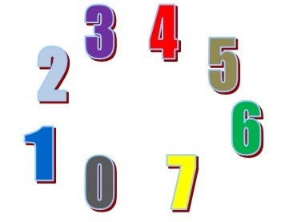
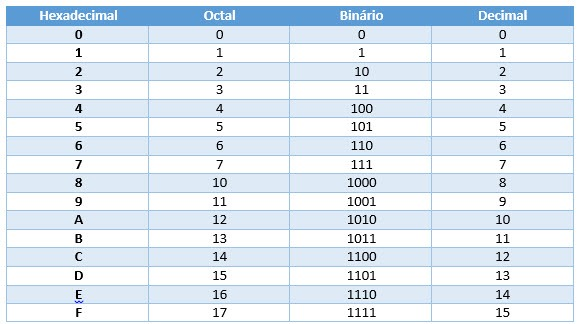

# Aula Conversao de Bases Explicacao Simples

> Extraído de `Aula_Conversao_de_Bases_Explicacao_Simples.pptx` (slides do Prof. Rafael) — 22 slides. Texto, tabelas e notas transcritos slide a slide; figuras em `imagens/Aula_Conversao_de_Bases_Explicacao_Simples/` (a imagem de fundo repetida em todos os slides, rodapés e números de página foram omitidos).

---

## Slide 1 — Sistema de Numeração Introdução à Lógica Digital

---

## Slide 2 — Bases Numéricas Decimal

- BASE

---

## Slide 3 — Bases Numéricas Binário

- BASE

---

## Slide 4 — Bases Numéricas Octal

- BASE

---

## Slide 5 — Bases Numéricas Hexadecimal

- BASE

---

## Slide 6 — O que é uma base numérica?

- BASE 2
- Binário
- 0–1

- BASE 10
- Decimal
- 0–9

- BASE 16
- Hexadecimal
- 0–9 + A–F

- BASE 8
- Octodecimal
- 0–7

- É a quantidade de símbolos ou algarismos que um sistema de numeração usa para representar quantidades e números

---

## Slide 7 — Os quatro sistemas

| Sistema | Base | Símbolos |
|---|---|---|
| Decimal | 10 | 0 a 9 |
| Binário | 2 | 0 e 1 |
| Octal | 8 | 0 a 7 |
| Hexadecimal | 16 | 0 a 9 e A a F |

- Primeiro descubra a base. Depois escolha o método de conversão.

---

## Slide 8 — Os quatro sistemas

*Tabela da figura (transcrita):*

| Hexadecimal | Octal | Binário | Decimal |
|---|---|---|---|
| 0 | 0 | 0 | 0 |
| 1 | 1 | 1 | 1 |
| 2 | 2 | 10 | 2 |
| 3 | 3 | 11 | 3 |
| 4 | 4 | 100 | 4 |
| 5 | 5 | 101 | 5 |
| 6 | 6 | 110 | 6 |
| 7 | 7 | 111 | 7 |
| 8 | 10 | 1000 | 8 |
| 9 | 11 | 1001 | 9 |
| A | 12 | 1010 | 10 |
| B | 13 | 1011 | 11 |
| C | 14 | 1100 | 12 |
| D | 15 | 1101 | 13 |
| E | 16 | 1110 | 14 |
| F | 17 | 1111 | 15 |

- Conversão de Bases Numéricas • Turma de Aprendizagem

---

## Slide 9 — 1. Decimal → Binário

- Método: divisões sucessivas por 2

- EXEMPLO: 25₁₀
- 25 ÷ 2 = 12 resto 1
- 12 ÷ 2 = 6 resto 0
- 6 ÷ 2 = 3 resto 0
- 3 ÷ 2 = 1 resto 1
- 1 ÷ 2 = 0 resto 1

- Regra: divida por 2 e anote os restos.

- Leia os restos de BAIXO para CIMA.

- 25₁₀ = 11001₂

---

## Slide 10 — Decimal → Binário

| Número | Divisões | Resultado |
|---|---|---|
| 13₁₀ | 13÷2, 6÷2, 3÷2, 1÷2 | 1101₂ |

- 13 ÷ 2 = 6
- resto 1

- 6 ÷ 2 = 3
- resto 0

- 3 ÷ 2 = 1
- resto 1

- 1 ÷ 2 = 0 → resto 1

---

## Slide 11 — 2. Decimal → Octal

- Método: divisões sucessivas por 8

- EXEMPLO: 83₁₀
- 83 ÷ 8 = 10 resto 3
- 10 ÷ 8 = 1 resto 2
- 1 ÷ 8 = 0 resto 1
- Leia de baixo para cima.

- 83₁₀ → 123₈

- Dica: decimal → octal = divide por 8.

---

## Slide 12 — 3. Decimal → Hexadecimal

- Método: divisões sucessivas por 16

| Decimal | Hexadecimal |
|---|---|
| 10 | A |
| 11 | B |
| 12 | C |
| 13 | D |
| 14 | E |
| 15 | F |

- EXEMPLO: 255₁₀
- 255 ÷ 16 = 15 resto 15
- 15 ÷ 16 = 0 resto 15

- 15 = F → 15 = F

- 255₁₀ = FF₁₆

---

## Slide 13 — 4. Binário → Decimal

- Método: multiplicar pelos pesos de 2

| Peso | 8 | 4 | 2 | 1 |
|---|---|---|---|---|
| Potência | 2³ | 2² | 2¹ | 2⁰ |
| Bit | 1 | 1 | 0 | 1 |

- 1×8 + 1×4 + 0×2 + 1×1 = 13

- 1101₂ = 13₁₀

---

## Slide 14 — 5. Octal → Decimal

- Método: multiplicar pelos pesos de 8

- EXEMPLO: 237₈
- Pesos:
- 64 8 1
- 2 3 7

- 2×64 = 128
- 3×8 = 24
- 7×1 = 7

- 128 + 24 + 7 = 159

- 237₈ = 159₁₀

---

## Slide 15 — 6. Hexadecimal → Decimal

- Método: multiplicar pelos pesos de 16

- EXEMPLO: 2A₁₆
- A = 10
- Pesos:
- 16 1
- 2 A

- 2×16 = 32
- A×1 = 10

- 32 + 10 = 42

- 2A₁₆ = 42₁₀

---

## Slide 16 — 7. Binário → Octal

- Método: agrupamento de 3 bits

- 101110₂

- 101

- 110

- 101110₂
- 56₈

- 101 = 5

- 110 = 6

- Dica: 3 bits → 1 algarismo octal.

---

## Slide 17 — 8. Binário → Hexadecimal

- Método: agrupamento de 4 bits

- 10101111₂

- 1010

- 1111

- 10101111₂
- AF₁₆

- 1010 = A

- 1111 = F

- Dica: 4 bits → 1 algarismo hexadecimal.

---

## Slide 18 — Tabela rápida — binário e hexadecimal

| Binário | Hex |
|---|---|
| 0000 | 0 |
| 0001 | 1 |
| 0010 | 2 |
| 0011 | 3 |
| 0100 | 4 |
| 0101 | 5 |
| 0110 | 6 |
| 0111 | 7 |
| 1000 | 8 |
| 1001 | 9 |
| 1010 | A |
| 1011 | B |
| 1100 | C |
| 1101 | D |
| 1110 | E |
| 1111 | F |

- Conversão de Bases Numéricas • Turma de Aprendizagem

---

## Slide 19 — Resumo — qual método devo usar?

| Conversão | Método |
|---|---|
| Decimal → Binário | Dividir por 2 |
| Decimal → Octal | Dividir por 8 |
| Decimal → Hexadecimal | Dividir por 16 |
| Binário → Decimal | Pesos / potências de 2 |
| Octal → Decimal | Pesos / potências de 8 |
| Hexadecimal → Decimal | Pesos / potências de 16 |
| Binário → Octal | Agrupar 3 bits |
| Binário → Hexadecimal | Agrupar 4 bits |

- Conversão de Bases Numéricas • Turma de Aprendizagem

---

## Slide 20 — Exercícios — faça no caderno

- 1) 5₁₀ → binário
- 2) 8₁₀ → binário
- 3) 10₁₀ → binário
- 4) 20₁₀ → octal
- 5) 31₁₀ → hexadecimal
- 6) 1010₂ → decimal
- 7) 1101₂ → decimal
- 8) 25₈ → decimal
- 9) 2A₁₆ → decimal
- 10) 10101111₂ → hexadecimal

---

## Slide 21 — As 4 regras para lembrar

- ÷ 2
- Decimal → Binário

- ÷ 8
- Decimal → Octal

- ÷ 16
- Decimal → Hex

- 3 ou 4 bits
- Binário → Octal/Hex

- E quando for para decimal: use os pesos da base.

---

## Slide 22 — Gabarito dos exercícios

| Exercício | Resposta |
|---|---|
| 5₁₀ → binário | 101₂ |
| 8₁₀ → binário | 1000₂ |
| 10₁₀ → binário | 1010₂ |
| 20₁₀ → octal | 24₈ |
| 31₁₀ → hexadecimal | 1F₁₆ |
| 1010₂ → decimal | 10₁₀ |
| 1101₂ → decimal | 13₁₀ |
| 25₈ → decimal | 21₁₀ |
| 2A₁₆ → decimal | 42₁₀ |
| 10101111₂ → hexadecimal | AF₁₆ |
