# Aula Sistemas Supervisorios SCADA IHM

> Extraído de `Aula_Sistemas_Supervisorios_SCADA_IHM.pptx` (slides do Prof. Rafael) — 26 slides. Texto, tabelas e notas transcritos slide a slide; figuras em `imagens/Aula_Sistemas_Supervisorios_SCADA_IHM/` (a imagem de fundo repetida em todos os slides, rodapés e números de página foram omitidos).

---

## Slide 1 — Sistema Supervisório/SCADA!!! O que é? Para que serve? Onde encontramos? Alguém conhece ?

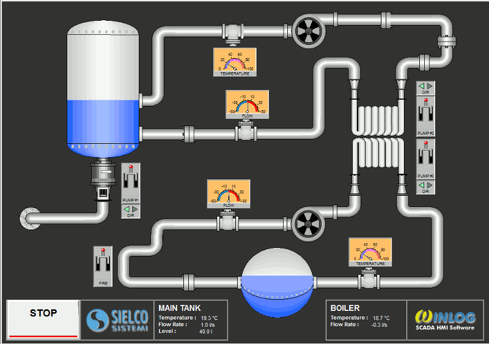

- Visualização

- Histórico

---

## Slide 2 — 1. O que é um sistema supervisório?

- Uma camada que transforma dados do processo em informação operacional.

- Visualização

- Histórico

- TELA SINÓTICA

- Ver o processo em tempo real

- Registrar dados e tendências

- PRESSÃO 4,2 bar
- VAZÃO 38 m³/h

- LEVEL
- 72%

- Alarmes

- Comandos

- Detectar desvios e eventos

- Permitir ações autorizadas

- ALARMES TENDÊNCIAS COMANDOS

---

## Slide 3 — SISTEMAS SUPERVISÓRIOS

- IHM • Supervisão Local e Remota • SCADA

- CAMPO

- CLP / UNIDADE TERMINAL REMOTA

- SCADA

- OPERADOR

- Da variável física à decisão: medir → controlar → supervisionar → agir

---

## Slide 4 — SISTEMAS SUPERVISÓRIOS

- EXEMPLO 1

- EXEMPLO 6

- CAMPO

- CLP / UNIDADE TERMINAL REMOTA

- SCADA

- OPERADOR

- EXEMPLO 2

- EXEMPLO 3

---

## Slide 5 — SISTEMAS SUPERVISÓRIOS

- Unidades Terminais Remotas (UTRs) São dispositivos que se conectão aos sensores do processo, convertendo os dados coletados em sinais digitais que por sua vez são enviados para o sistema de armazenamento de dados para que sejam disponibilizados conforme necessidade (sistema de supervisão, controle de inventário , etc)

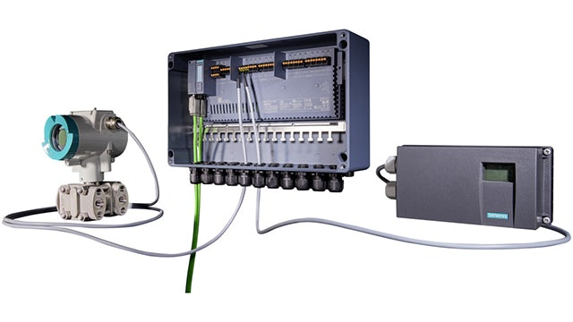

---

## Slide 6 — SISTEMAS SUPERVISÓRIOS

- Controlador lógico programável (PLCs) ou Controlador Programável: é um computador industrial que foi reforçado e adaptado para o controle de processos de fabricação.

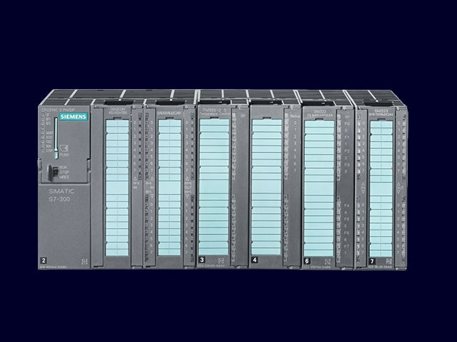

---

## Slide 7 — SISTEMAS SUPERVISÓRIOS

- Supervisório: Sistema de supervisão que reúne todos os dados necessários sobre o processo.

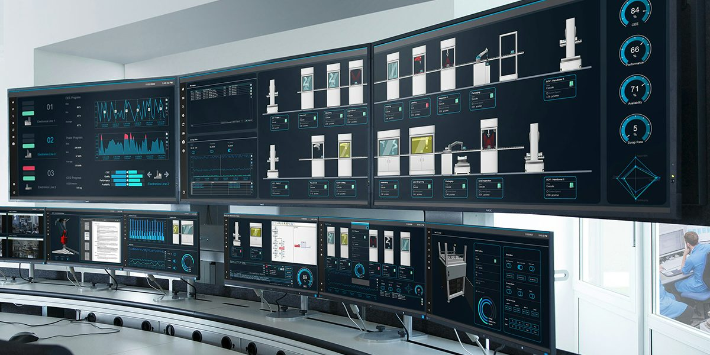

---

## Slide 8 — 2. Sistema SCADA!

- SCADA significa Controle de Supervisão e Aquisição de Dados, mas é um termo frequentemente usado para coleta e apresentação de dados.
- Na maioria dos casos esse sistema SCADA reúne um pacote de software projetado para exibir informações, registrar dados e mostrar alarmes.

- Visualização

- Histórico

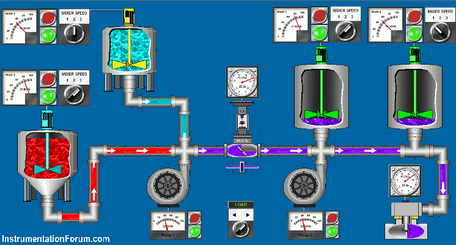

- Alarmes

- Comandos

---

## Slide 9 — 2.1 Exemplos de SCADA.

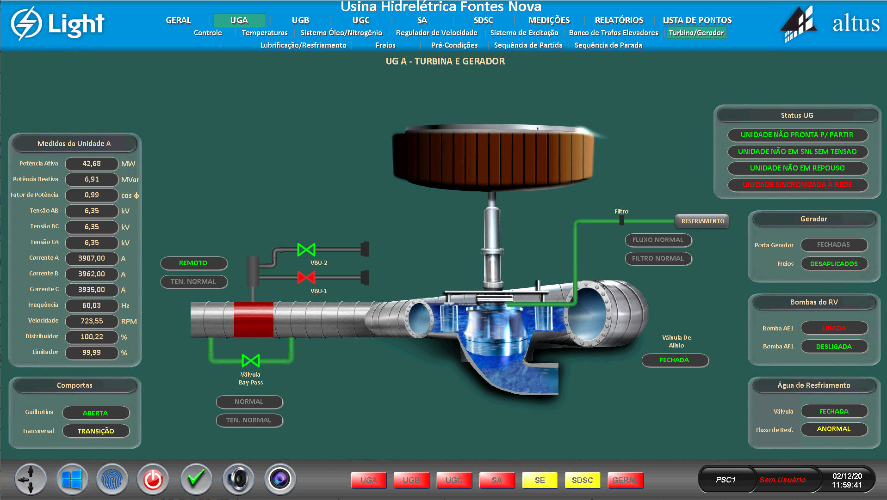

---

## Slide 10 — 2.1 Exemplos de SCADA.

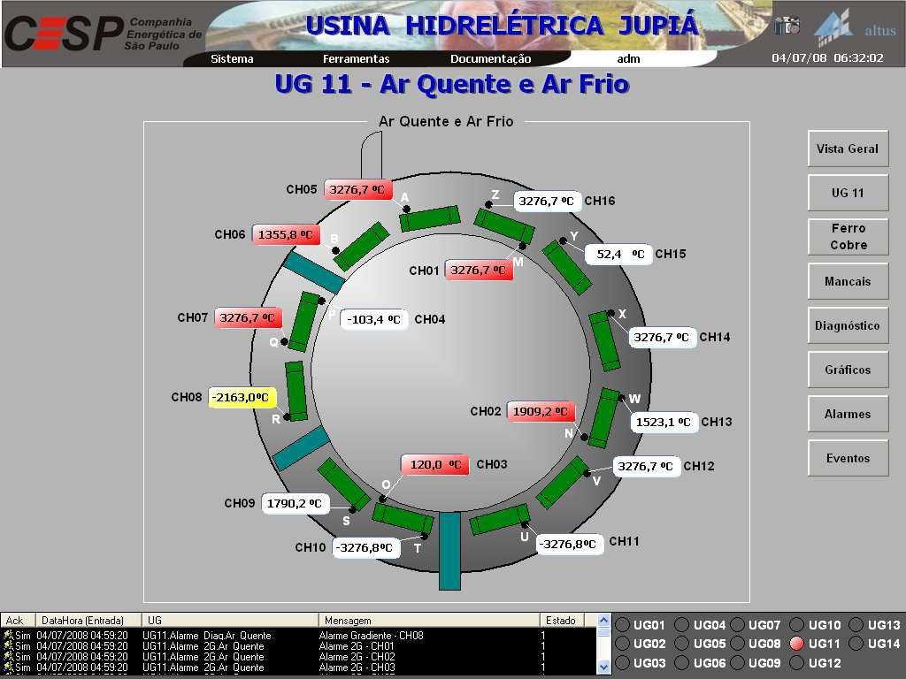

---

## Slide 11 — 2.1 Exemplos de SCADA.

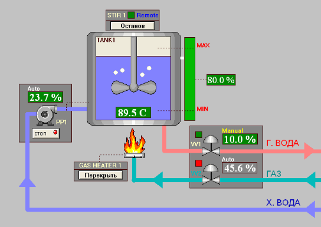

---

## Slide 12 — ONDE SÃO APLICADOS OS SISTEMA SCADA:

- EXEMPLO 1: ?
- EXEMPLO 2: ?
- EXEMPLO 3: ?
- EXEMPLO 4: ?

---

## Slide 13 — 3. IHM — Interface Homem-Máquina

- O ponto de interação entre operador e equipamento/processo.

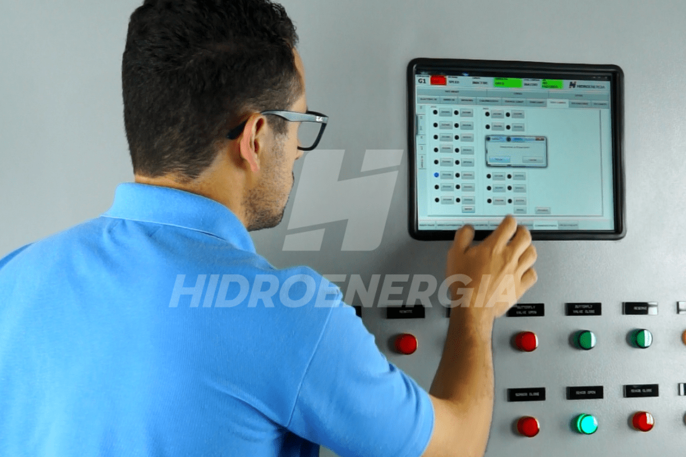

- • Exibe estados, valores e condições do processo.
- • Permite comandos e ajustes autorizados.
- • Apresenta alarmes e mensagens ao operador.
- • Pode mostrar tendências, receitas e diagnósticos.
- • Normalmente está próxima da máquina ou célula.

- IHM LOCAL

- PRESSÃO 4,2 bar
- VAZÃO 38 m³/h

- LEVEL
- 72%

- IHM ≠ CLP
- A IHM apresenta e interage; o CLP executa a lógica de controle.

- ALARMES TENDÊNCIAS COMANDOS

---

## Slide 14 — 4. IHM x SCADA

- Mesma ideia de interação, mas em níveis diferentes de supervisão.

- IHM — visão local

- SCADA — visão supervisória

- • Uma máquina ou célula
- • Operação junto ao processo
- • Tela dedicada
- • Diagnóstico local
- • Resposta rápida do operador

- • Várias máquinas/áreas
- • Sala de controle ou acesso remoto
- • Múltiplas telas e usuários
- • Alarmes e histórico centralizados
- • Análise e integração de dados

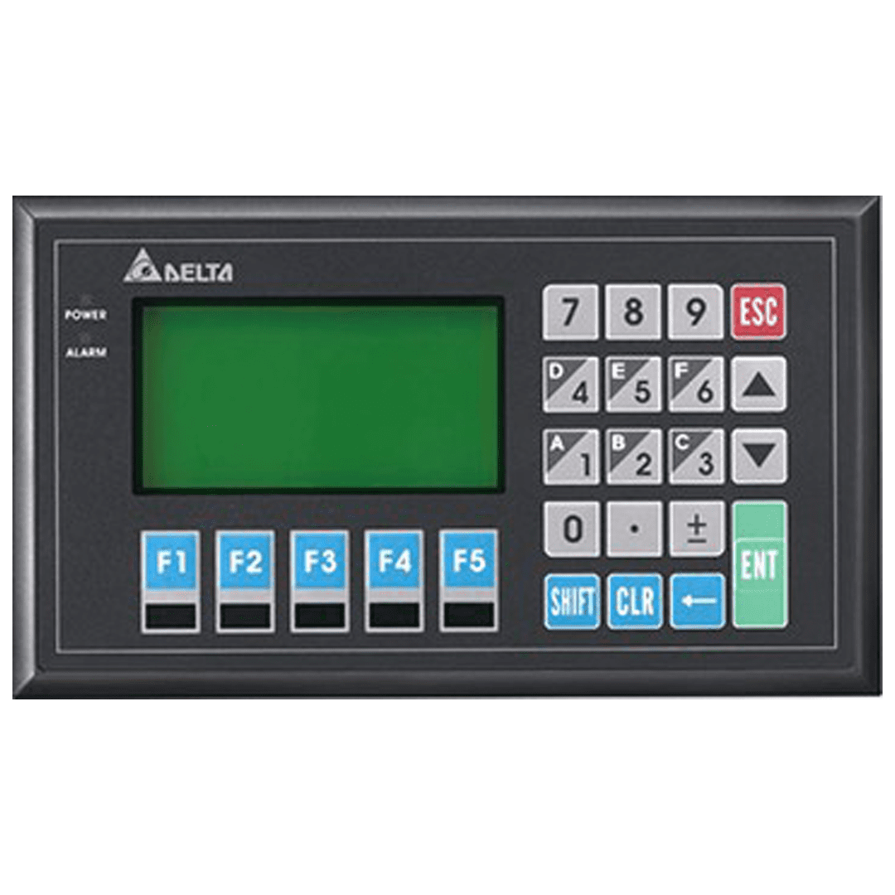

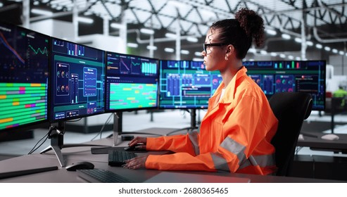

- Regra prática: IHM tende a ser local e focada; SCADA tende a ser centralizado e abrangente.

---

## Slide 15 — 5. Supervisão Local e Remota

- A mesma planta pode ser acompanhada em diferentes pontos da operação.

- SUPERVISÃO LOCAL

- SUPERVISÃO REMOTA

- SCADA

- PRESSÃO 4,2 bar
- VAZÃO 38 m³/h

- IHM

- PRESSÃO 4,2 bar
- VAZÃO 38 m³/h

- LEVEL
- 72%

- LEVEL
- 72%

- ALARMES TENDÊNCIAS COMANDOS

- ALARMES TENDÊNCIAS COMANDOS

- Operador no painel • rede local • comandos próximos do equipamento

- Acesso por rede/Internet segura • operação distribuída • múltiplas unidades • telemetria

---

## Slide 16 — 6. Arquitetura típica de um sistema de supervisão

- Fluxo da informação: campo → controle → comunicação → supervisão.

- Sensores /
- atuadores

- CLP / RTU

- Rede
- industrial

- Servidor
- SCADA

- IHM / Cliente

- COMANDOS / SETPOINTS

- Componentes podem variar conforme a aplicação: switches, gateways, bancos de dados, historiadores, servidores redundantes e estações de engenharia.

---

## Slide 17 — 7. Componentes do sistema de supervisão

- Hardware, software, comunicação e pessoas formam o conjunto.

- Campo

- Controle

- Comunicação

- Sensores, transmissores,
- atuadores e motores

- CLPs, UTR e IPC’S

- Ethernet industrial,
- Modbus, Profibus etc.

- Supervisão

- Operação

- Dados

- Servidor SCADA,
- clientes e banco de dados

- IHMs, PCs,
- celulares e painéis.

- Histórico, alarmes,
- relatórios e eventos

---

## Slide 18 — 8. Softwares SCADA

- Exemplos de plataformas utilizadas na indústria.

- SIEMENS
- WinCC

- ALSTOM
- Alspa P 320

- CEPEL
- Sage

- Visualização • alarmes • histórico • comunicação

- Visualização • alarmes • histórico • comunicação

- Visualização • alarmes • histórico • comunicação

- Elipse

- GE Vernova
- Proficy

- Schneider
- Pacis

- Visualização • alarmes • histórico • comunicação

- Visualização • alarmes • histórico • comunicação

- Visualização • alarmes • histórico • comunicação

- A escolha depende de requisitos como integração, escala, redundância, protocolos, histórico, cibersegurança e custo.

---

## Slide 19 — 9. Funções básicas dos sistemas de supervisão

- O supervisório não é apenas uma tela: ele organiza a informação operacional.

- Aquisição de dados

- Ler variáveis e estados

- Visualização

- Representar o processo

- Alarmes

- Avisar desvios e falhas

- Tendências

- Mostrar comportamento no tempo

- Histórico

- Registrar dados e eventos

- Comandos

- Enviar ações autorizadas

---

## Slide 20 — 10. Alarmes e eventos

- Alarmes devem apoiar a decisão — não criar excesso de informação.

- Exemplo de lista de alarmes

- Boas práticas

- • Priorizar criticidade
- • Usar mensagens claras
- • Evitar alarmes repetitivos
- • Permitir reconhecimento
- • Registrar data e hora
- • Definir responsáveis

- Pressão do tanque

- 4,8 bar

- ALTO

- Nível baixo

- 22 %

- ATENÇÃO

- Bomba P-101

- Ligada

- NORMAL

- Operador reconheceu alarme

- 15:42

- EVENTO

---

## Slide 21 — 11. Tendências, históricos e relatórios

- O histórico transforma o dado instantâneo em informação para análise.

- Tendência de temperatura — últimos 30 min

- Média

- Máxima

- Mínima

- 72,4 °C

- 78,1 °C

- 66,8 °C

- Aplicações:
- produção • manutenção • qualidade • eficiência

---

## Slide 22 — 12. Operação remota e arquitetura distribuída

- Quando a planta está espalhada, a supervisão pode ser centralizada.

- USINA A

- WAN

- CLP / RTU

- CENTRO DE OPERAÇÃO

- REDE
- SEGURA

- PRESSÃO 4,2 bar
- VAZÃO 38 m³/h

- LEVEL
- 72%

- USINA B

- CLP / RTU

- ALARMES TENDÊNCIAS COMANDOS

- USINA C

- CLP / RTU

- Acesso remoto • dashboards • alarmes • histórico

---

## Slide 23 — 11. Exemplo prático — supervisão de uma usina hidrelétrica

- Sensores, CLPs/RTUs, rede e SCADA trabalhando juntos na supervisão da geração.

- PROCESSO

- CONTROLE

- SCADA

- REDE

- Vazão

- CLP

- NET

- USINA • GERAÇÃO

- RESERVATÓRIO
- Nível 84%

- TURBINA

- P = 128 MW

- Proteções
- intertravamentos

- V = 13,8 kV

- Ethernet
- Fibra / rádio
- Protocolos

- Pressão
- Vazão
- Nível

- Alarmes • tendências
- histórico • comandos

- GERADOR

- OPERADOR — acompanha, analisa e comanda

- Sensores medem nível, vazão, pressão, tensão, corrente e temperatura.

- CLP/RTU processa sinais, proteções e intertravamentos.

- SCADA apresenta estados, alarmes, tendências e histórico.

- O operador toma decisões e envia comandos autorizados.

- Supervisão

- Campo

- Controle

- Operação

---

## Slide 24 — 12. Atividade para os alunos

- Identifique cada camada e explique o caminho do dado.

- Sensor de nível

- CLP

- Rede

- SCADA

- Operador

- Desafio: o que acontece se a comunicação com o SCADA cair? O CLP continua controlando?

- Resposta esperada: o controle local deve continuar conforme a arquitetura projetada; a supervisão pode perder visibilidade.

---

## Slide 25 — 13. Resumo da aula

- Cinco ideias para levar para casa:

- IHM

- Interação local entre operador e máquina.

- SCADA

- Supervisão, aquisição de dados e visão integrada.

- Local x remoto

- Acesso depende da arquitetura e comunicação.

- Funções

- Visualização, alarmes, tendências, histórico e comandos.

- Arquitetura

- Campo → controle → rede → supervisão → operação.

- Próximo passo: criar uma tela supervisória simples para uma partida de motor.

---

## Slide 26 — Fontes e referências

- Materiais consultados para conceitos e exemplos de plataformas.

- • Siemens — SIMATIC HMI / visualização industrial
- • Inductive Automation — arquiteturas SCADA / Ignition
- • GE Vernova — Proficy HMI/SCADA
- • Schneider Electric — EcoStruxure / software IHM e SCADA
- • Omron — Movicon.NExT
- • Referências didáticas sobre SCADA, IHM e automação industrial

- Observação: os exemplos de software são ilustrativos; funções e licenciamento variam conforme a versão e o fabricante.
