# Aula Variaveis de Controle Visual Com Figuras Embutidas

> Extraído de `Aula_Variaveis_de_Controle_Visual_Com_Figuras_Embutidas.pptx` (slides do Prof. Rafael) — 24 slides. Texto, tabelas e notas transcritos slide a slide; figuras em `imagens/Aula_Variaveis_de_Controle_Visual_Com_Figuras_Embutidas/` (a imagem de fundo repetida em todos os slides, rodapés e números de página foram omitidos).

---

## Slide 1 — VARIÁVEIS DE CONTROLE

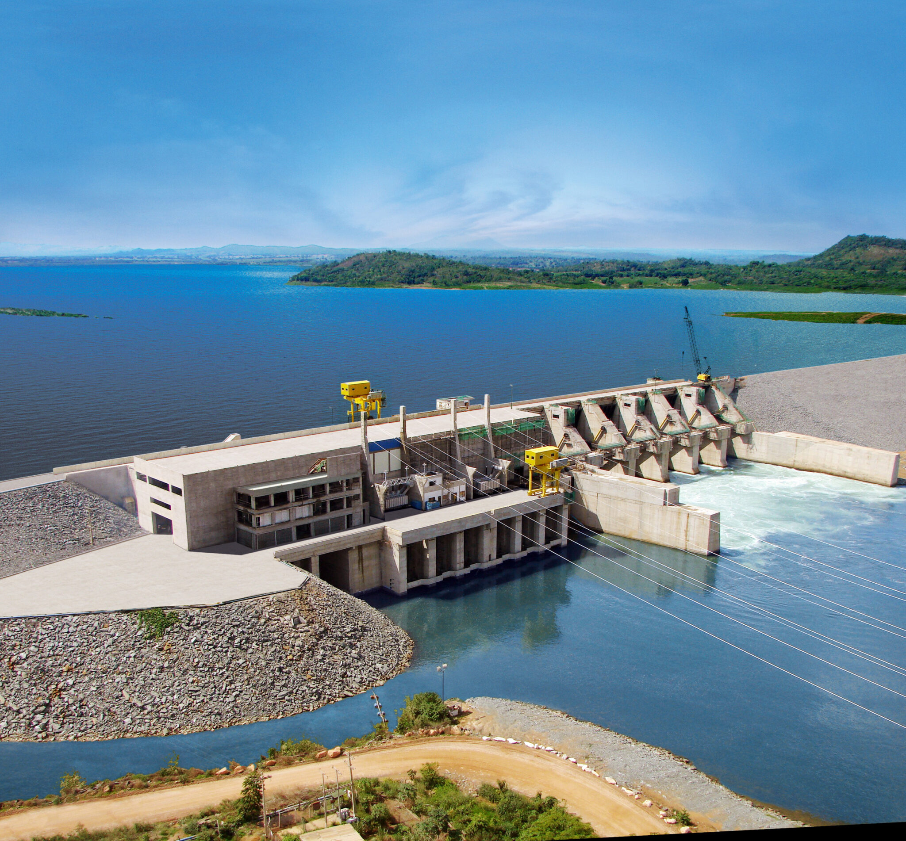

- Pressão • Vazão
- Temperatura • Nível

- USIA

- Aula visual de Instrumentação Industrial

- CURSO TÉCNICO • AUTOMAÇÃO / ELETROTÉCNICA/APRENDIZAGEM EM AUTOMAÇÃO

---

## Slide 2 — O que vamos aprender?

- PRESSÃO

- VAZÃO

- TEMPERATURA

- NÍVEL

- Quantidade em um tanque.

- Fluxo de líquidos e gases.

- Estado térmico do processo.

- Força exercida por um fluido.

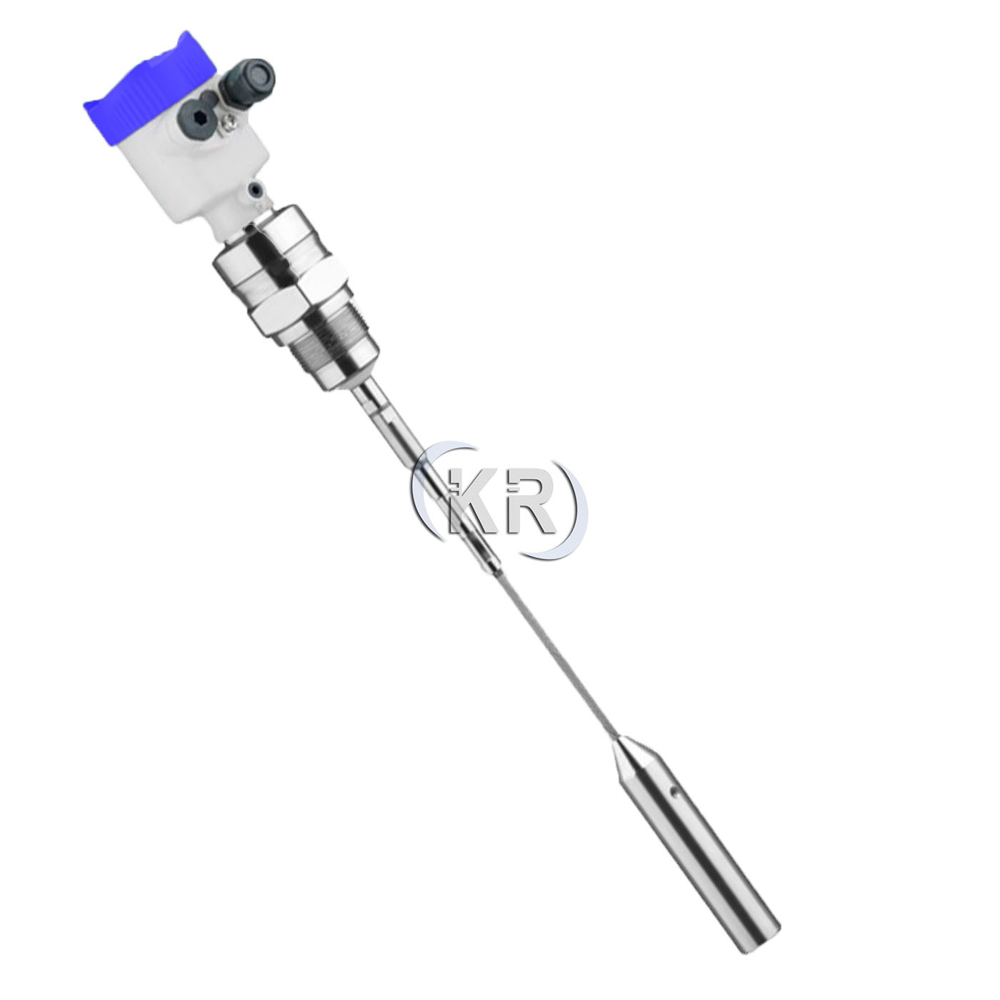

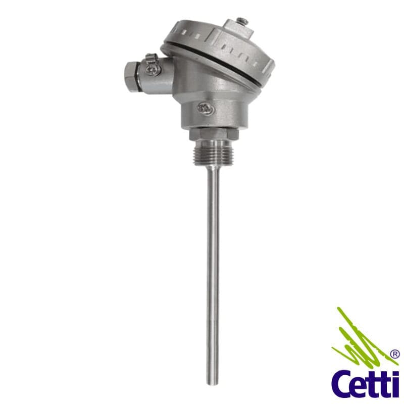

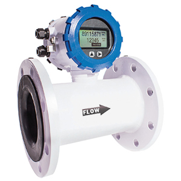

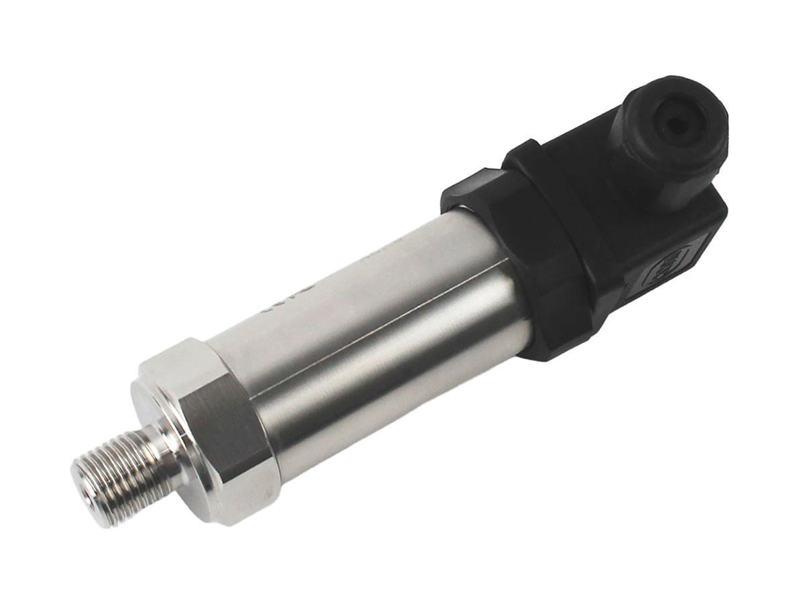

- Depois: sensor → transmissor → CLP → atuador

---

## Slide 3 — O que é uma variável de processo?

- É uma grandeza que podemos medir e acompanhar.

- PROCESSO

- SENSOR

- SINAL

- CLP

- ATUADOR

- EXEMPLO

- MEDIÇÃO

- AÇÃO

- Temperatura de um forno = 180 °C

- O sensor percebe a grandeza.

- O atuador altera o processo.

---

## Slide 4 — 1. PRESSÃO

- Quanto uma força está sendo exercida sobre uma área.

- P = F / A

- UNIDADES

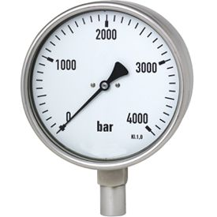

- Pressão = força ÷ área.

- bar • psi • kPa • MPa

- • Tubulações
- • Bombas
- • Compressores
- • Caldeiras

---

## Slide 5 — Pressão | Instrumentos

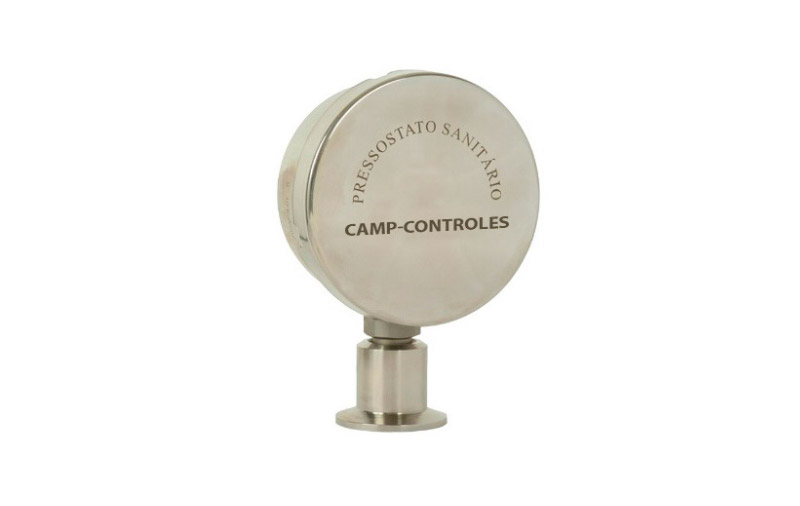

- TRANSMISSOR

- PRESSOSTATO

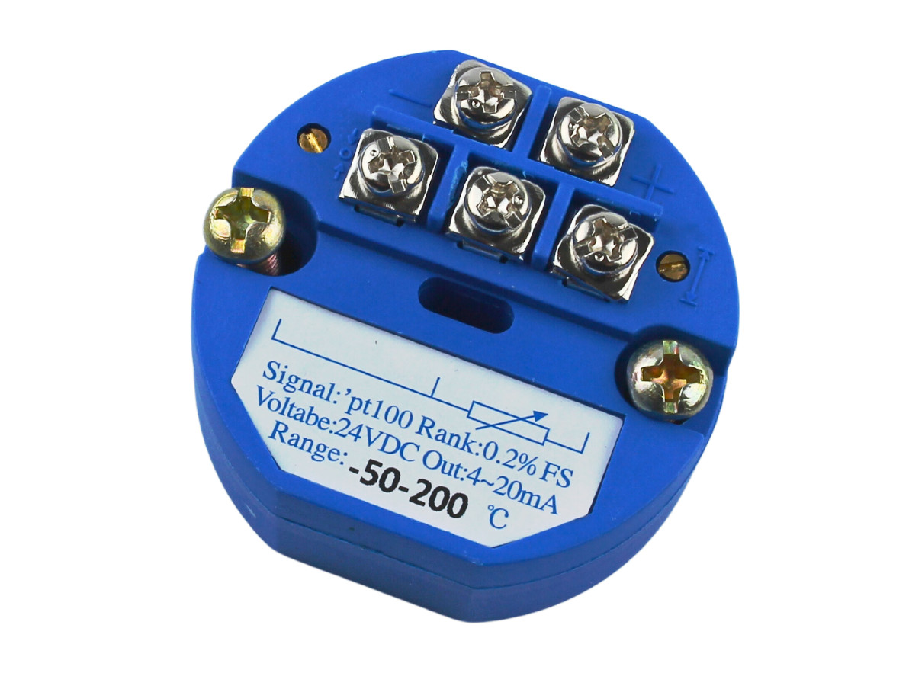

- 4–20 mA

- abre/fecha

- bar

- MANÔMETRO

- PRESSOSTATO

- TRANSMISSOR

- Leitura local.

- Comuta por limite.

- Envia o sinal ao CLP.

---

## Slide 6 — 2. VAZÃO

- Quanto fluido passa por um ponto durante um tempo.

- Q = V / t

- EXEMPLOS

- FLOW

- Vazão volumétrica.

- L/min • m³/h • kg/h

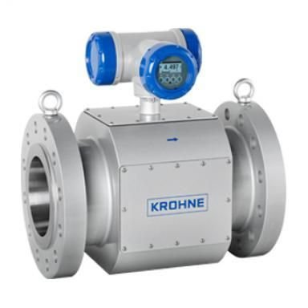

- ONDE USAMOS?

- • Água
- • vapor
- • ar comprimido
- • combustível

---

## Slide 7 — Vazão | Diferentes medidores

- ELETROMAGNÉTICO

- ULTRASSÔNICO

- Muito usado em água e fluidos condutivos.

- Usa ondas ultrassônicas.

- CORIOLIS

- VORTEX

- Mede vazão mássica.

- Comum em vapor e gases.

---

## Slide 8 — 3. TEMPERATURA

- Uma das variáveis mais presentes na indústria.

- TERMOPAR

- PT100

- Muito usado em
- fornos e altas temperaturas.

- Sensor resistivo
- muito usado em processos.

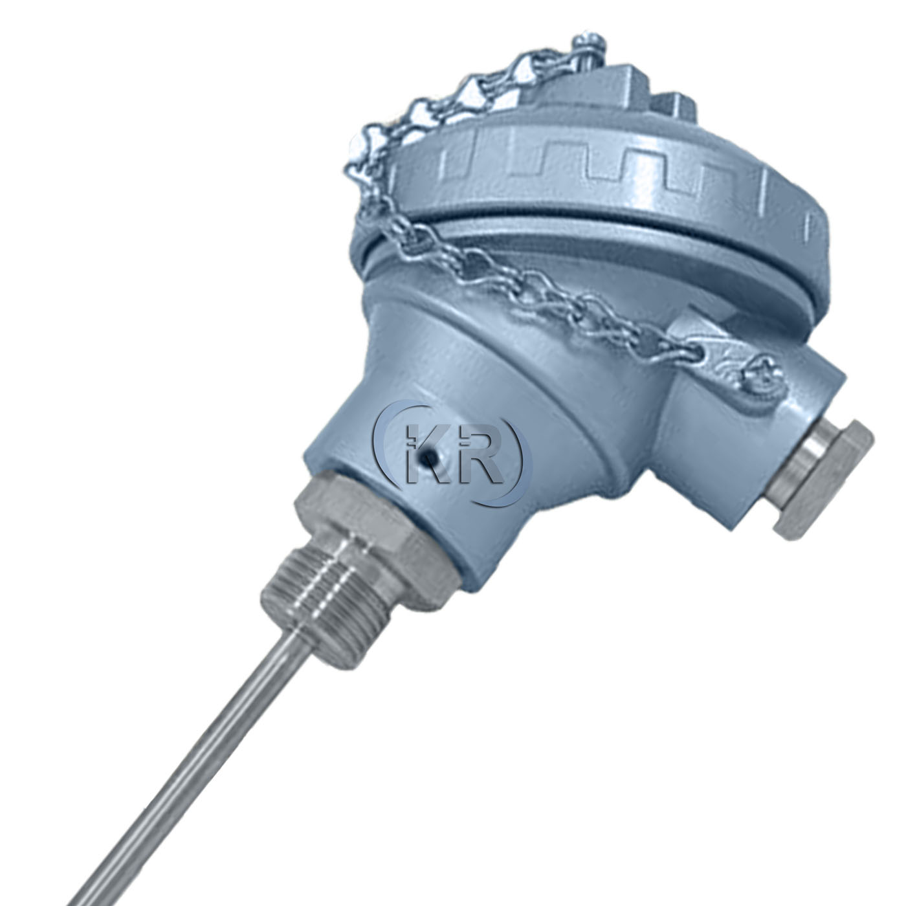

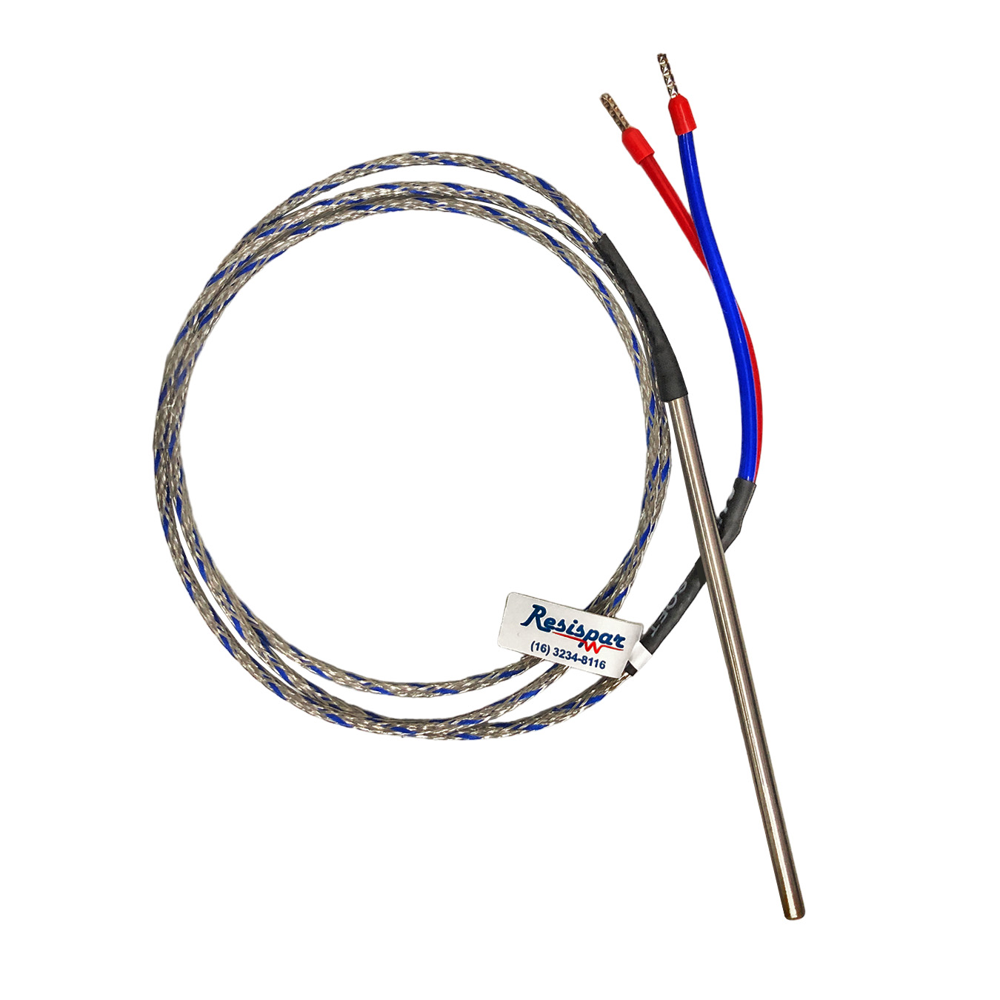

- EXEMPLOS

- Motores • mancais • óleo • fornos • caldeiras

- TERMOPARES

---

## Slide 9 — 4. NÍVEL

- Quanto material existe dentro de um tanque.

- RADAR

- BOIA

- Solução simples.

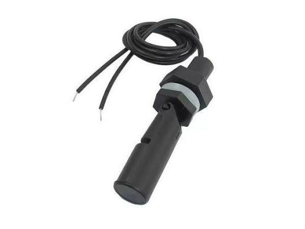

- 72 %

- 62 %

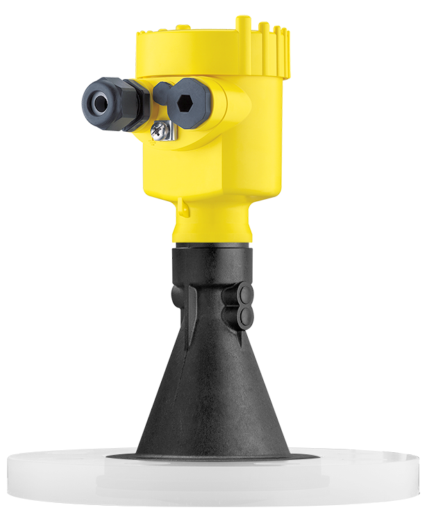

- RADAR

- Mede a distância até a superfície.

---

## Slide 10 — Nível | Por que controlar?

- EVITAR TRANSBORDAMENTO

- GARANTIR ALIMENTAÇÃO

- MANTER ESTABILIDADE

- Tanque cheio demais pode
- causar perdas, riscos e paradas.

- Um nível mínimo
- pode ser necessário para
- manter o processo funcionando.

- O nível pode precisar
- permanecer próximo de
- um valor desejado.

---

## Slide 11 — E existem muitas outras variáveis…

- VELOCIDADE

- POSIÇÃO

- CORRENTE

- RPM de motores e turbinas.

- Válvulas, eixos e comportas.

- Carga e comportamento de motores.

- VIBRAÇÃO

- UMIDADE

- Condição mecânica.

- Qualidade de água e processos.

- Secagem e armazenamento.

---

## Slide 12 — Sensor × Transmissor

- Não são exatamente a mesma coisa.

- SENSOR

- TRANSMISSOR

- É o elemento que percebe a grandeza.
- Ex.: termopar, PT100, célula de pressão,
- boia e sensor ultrassônico.

- Recebe a informação e gera um sinal padronizado.
- Exemplo: 0–10 bar → 4–20 mA.

---

## Slide 13 — A malha de controle

- A medição vira uma ação.

- SENSOR

- TRANSMISSOR

- CLP / PID

- ATUADOR

- PROCESSO

- 1. MEDIR

- 2. DECIDIR

- 3. CORRIGIR

- O sensor mede.

- O controlador compara.

- O atuador altera o processo.

---

## Slide 14 — SP e PV | Uma ideia muito importante

- SP – SETPOINT

- PV – PROCESS VARIABLE

- ERRO

- O valor que queremos.
- 🎯 Ex.: 80 °C

- O valor que temos.
- 🌡️ Ex.: 75 °C

- SP − PV
- 80 − 75 = 5 °C

- O controlador trabalha para reduzir o erro.

---

## Slide 15 — 4–20 mA | Como interpretar

- ZERO VIVO

- 4 mA

- 8 mA

- 12 mA

- 16 mA

- 20 mA

- 4 mA = início do range.

- 25%

- 50%

- 75%

- 100%

- EXEMPLO

- 0–10 bar
- 12 mA = 5 bar

---

## Slide 16 — Exemplo rápido | 14 mA vale quanto?

- DADO

- CONTA

- RESPOSTA

- Transmissor 0–10 bar
- Sinal = 14 mA

- (14−4) ÷ (20−4)
- = 62,5%

- 62,5% × 10 bar
- = 6,25 bar

- Resposta: 14 mA → 6,25 bar

---

## Slide 17 — Exemplo prático | Controle de nível

- TANQUE

- TRANSMISSOR

- CLP

- VÁLVULA

- AÇÃO

- Nível desejado = 70%

- Nível medido = 60%

- Aumentar a entrada,
- se essa for a estratégia.

---

## Slide 18 — Atividade para a turma

- Pense como um técnico de automação.

- SITUAÇÃO

- PERGUNTAS

- Um tanque possui transmissor de nível 0–100%
- → 4–20 mA.
- CLP recebe 16,8 mA.
- Setpoint = 80%.

- 1. Qual é o nível?
- 2. Está acima ou abaixo do SP?
- 3. Qual é a variável controlada?
- 4. Qual é a variável manipulada?
- 5. O que acontece se a válvula travar?

---

## Slide 19 — Atividade | Resposta

- NÍVEL

- COMPARAÇÃO

- CONTROLADA

- 16,8 mA = 80%

- PV = SP
- → no valor desejado.

- Nível do tanque.

- MANIPULADA

- FALHA

- Abertura da válvula / vazão.

- Se a válvula travar,
- o processo pode deixar de responder.

---

## Slide 20 — Quando uma medição parece errada…

- PROCESSO

- SENSOR

- TRANSMISSOR

- CABO / LOOP

- CLP

- • A variável realmente mudou?
- • O sensor está instalado corretamente?
- • O transmissor está alimentado?
- • O sinal está entre 4 e 20 mA?
- • A escala no CLP está correta?

---

## Slide 21 — Da instrumentação à Indústria 4.0

- Medições geram dados para operação e decisão.

- SENSOR

- CLP

- IHM / SCADA

- HISTÓRICO

- ANÁLISE

- VISUALIZAR

- ANALISAR

- MELHORAR

- Tendências e alarmes.

- Encontrar anomalias.

- Eficiência e manutenção.

---

## Slide 22 — Aplicação | Usina Hidrelétrica

- USINA

- PRESSÃO

- VAZÃO

- Circuitos hidráulicos.

- Água nos mancais.

- NÍVEL

- VIBRAÇÃO

- Reservatório.

- Turbinas e geradores.

- As mesmas variáveis aparecem em processos reais de
- geração de energia.

---

## Slide 23 — Resumo

- Pressão

- Vazão

- Temperatura

- Nível

- IDEIA-CHAVE

- MEDIR → COMPARAR → DECIDIR → ATUAR

---

## Slide 24 — PARA LEMBRAR

- “Uma boa automação começa com uma boa medição.”

- Pressão • Vazão • Temperatura • Nível

- Sensor → Transmissor → CLP → Atuador
