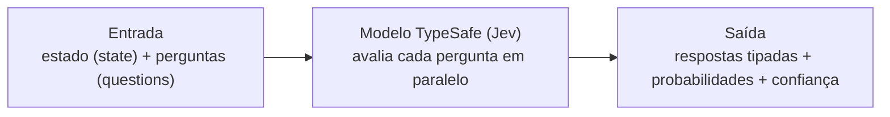

# 📄 Documentação TypeSafe — Introdução (resumo em português)

**Fonte:** <https://docs.typesafe.ai/introduction> · consultada em 2026-10-03
**Índice completo da documentação:** <https://docs.typesafe.ai/llms.txt>

> Resumo fiel da página de introdução, em português. Para o funcionamento detalhado e o roteiro de
> implementação neste projeto, ver `CLAUDE.md` desta pasta.

---

## 1. Introdução

- **Jev** é o modelo principal da TypeSafe e o **primeiro modelo System One**.
- Modelos de linguagem tradicionais geram **texto para pessoas**. Quando o software precisa de uma
  **decisão estruturada**, esse texto ainda tem de ser interpretado (*parsing*), o que gera
  desalinhamento e erros.
- O Jev resolve isso devolvendo **valores tipados e distribuições de probabilidade**, sem gerar
  texto e sem precisar de *parsing*.

## 2. Fluxo

## 3. Primitivas TypeSafe

| Primitiva | O que faz | O que devolve |
|---|---|---|
| **Choice** | Escolhe **uma** opção de uma lista | `choice`, probabilidades de cada opção e confiança |
| **Score** | Classifica o estado segundo uma **rubrica** (níveis ordenados) | `score`, probabilidades e confiança |
| **Noul** | Verifica se uma **afirmação** é verdadeira | valor de **0 a 1** |

Várias perguntas podem ser combinadas **numa única chamada**; o modelo avalia todas **em paralelo**.

## 4. Perguntas atômicas

- Cada pergunta deve ser **específica e bem delimitada**, como um julgamento que um especialista
  faria **em poucos segundos**.
- Pergunta complexa deve ser **decomposta** em várias perguntas menores e independentes, enviadas
  juntas na mesma chamada.

**Exemplo (desta UC):** em vez de perguntar "este caso de teste está bom?", enviar três `Noul`
independentes: "tem pré-condição?", "tem passos numerados?", "tem resultado esperado verificável?".

## 5. Próximas etapas (links da documentação)

| Página | Link |
|---|---|
| Quick Start | <https://docs.typesafe.ai/introduction/quickstart> |
| AI Primer (Machine Learning Primer) | <https://docs.typesafe.ai/introduction/machine-learning-primer> |
| Primitives | <https://docs.typesafe.ai/primitives> |
| Confidence | <https://docs.typesafe.ai/confidence> |
| Patterns | <https://docs.typesafe.ai/patterns> |
